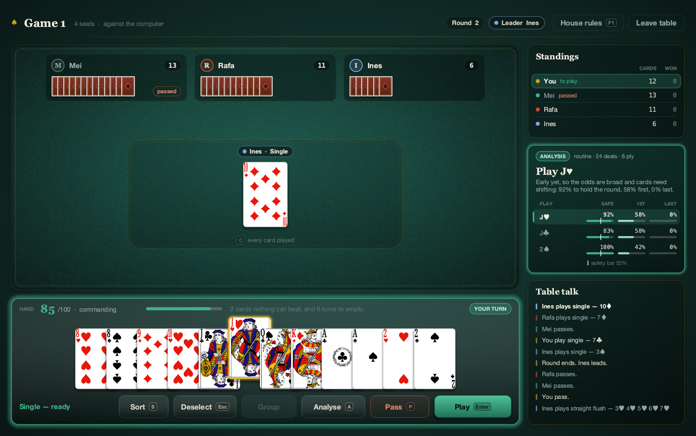

# Big Two Parlour

A desktop game of **Chinese Standard Big Two** (锄大地 / 大老二) for macOS, Windows and Linux.

- **Play** against computer opponents, 2, 3 or 4 to a table.
- **Analyse a real game:** record a game at a physical table as it happens, and get the engine's advice on your turn.



This repository holds the downloadable releases only.

## Download

Get the latest `BigTwoParlour-x.y.z.jar` from the [Releases page](../../releases/latest).

## Run

You need **Java 17 or newer**. If you don't have it, install a free JDK such as [Adoptium Temurin](https://adoptium.net/). Then:

```
java -jar BigTwoParlour-1.0.0.jar
```

On macOS and Windows you can usually double-click the jar instead. Everything, including the card artwork, is inside the one file.

## The rules

This is one specific variant, and the rules are fixed:

- **Ranks** `3 < 4 < 5 < 6 < 7 < 8 < 9 < 10 < J < Q < K < A < 2`; **suits** `♣ < ♦ < ♥ < ♠`.
- The whole deck is dealt: 26 each for two players, 18/17/17 for three, 13 each for four.
- Whoever holds the **3♣** leads first, and that play must contain it.
- **Hands:** single, pair, straight, full house, four of a kind (plus any fifth card), straight flush, and the Dragon (one card of every rank). There are no triples and no plain flushes.
- Straights run from `3-4-5-6-7` up to `J-Q-K-A-2`. They don't wrap round, so `A-2-3-4-5` is not a straight.
- Outside of bombs, a play must match the pile's card count and type: a full house does not beat a straight, or the other way round.
- **Bombs** (four of a kind < straight flush < Dragon) can be played on anything.
- The first player out wins, and the rest play on for the places behind.

Press `F1` in the game to see the rules at any time.

## Controls

| Key | Action |
| --- | --- |
| `Enter` | play the selected cards |
| `P` | pass |
| `A` | analyse the position |
| `C` | see every card played so far |
| `S` | sort your hand by rank or by suit |
| `U` | undo the last entry, while recording a real game |
| `Esc` | clear the selection |
| `F1` | show the rules |

## Your data

Settings and a log of finished games (`games.log`) are kept on your own computer, in `~/Library/Application Support/BigTwoParlour/` on macOS, `%APPDATA%\BigTwoParlour\` on Windows, and `~/.config/BigTwoParlour/` elsewhere. The game never connects to the internet.
